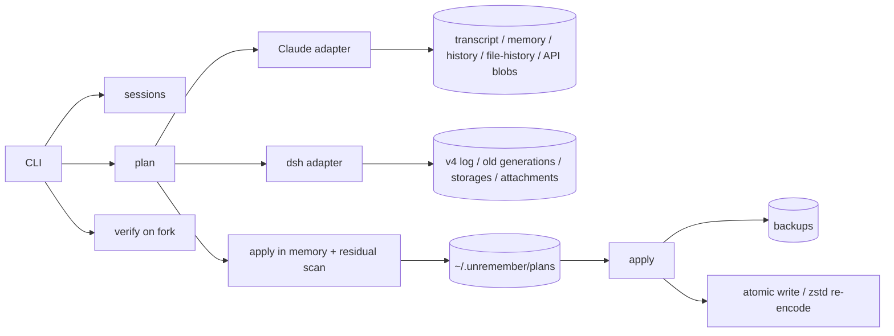

# unremember

<p align="center"></p>

<p align="center"><strong>Give a local coding agent a bowl of amnesia.</strong></p>

> 定向删掉一段内容，连同它的复述和会话外副本，然后用追问证明它真的忘了。  

[](https://github.com/lijiaqimun-coder/unremember/actions/workflows/ci.yml)
[](https://www.npmjs.com/package/unremember)
[](https://github.com/lijiaqimun-coder/unremember/releases)
[](https://github.com/lijiaqimun-coder/unremember/blob/main/LICENSE)
[](package.json)

`unremember` is a local-first privacy tool for **Claude Code** and **dsh** (DeepSeek Harness). It does not just delete a chat row. It removes the target from the transcript, its echoes, and the off-session copies, then verifies the result on a fork.

```
plan → inspect → backup → apply → verify → rollback if needed
```

No server, no account, no telemetry. It reads and writes the files you already own.

---

## Why

Deleting a message from the UI is not forgetting:

- Claude Code keeps the transcript, `history.jsonl`, auto-memory, `file-history`, API request blobs and compact summaries.
- dsh duplicates prompts into `agent/inbox/spliced`, keeps old generations, Zstandard logs and storage caches.
- A running agent has already loaded the old context into memory; editing the file underneath it is not enough.
- Compaction can replace old messages with a summary — the summary is a **new copy** of the secret.
- Verification must happen on a fork, otherwise the questions themselves pollute the original session.

`unremember` treats all of these as first-class stores, refuses formats it does not understand, and gives you a plan before touching anything.

## Install / Download

### npm

```bash
npm install -g unremember
unremember --version
```

The registry serves **1.0.2** as `latest`. The GitHub Release below is the same 1.0.2 build.

One-shot:

```bash
npx unremember --version
```

### GitHub Release

Download the latest package tarball from [Releases](https://github.com/lijiaqimun-coder/unremember/releases). The release asset is a ready-to-install package (built `dist/` included):

```bash
npm install -g ./unremember-1.0.2.tgz
unremember --version
```

### Install directly from GitHub

```bash
npm install -g github:lijiaqimun-coder/unremember
unremember --help
```

`prepare` builds the TypeScript source during install. If your npm blocks lifecycle scripts, clone and build manually:

```bash
git clone https://github.com/lijiaqimun-coder/unremember.git
cd unremember
npm ci
npm run build
npm link
```

### One-shot from GitHub

```bash
npx github:lijiaqimun-coder/unremember --help
```

### 国内加速

下面的 GitHub 代理和 npm 镜像都是第三方服务，可用性不由本项目保证；公司网络可能禁止：

```bash
# GitHub 代理（示例，第三方）
git clone https://ghproxy.net/https://github.com/lijiaqimun-coder/unremember.git
cd unremember

# 依赖走 npmmirror
npm --registry=https://registry.npmmirror.com ci
npm run build
npm link
```

Release 包也可以用同样前缀下载：

```text
https://ghproxy.net/https://github.com/lijiaqimun-coder/unremember/releases/download/v1.0.2/unremember-1.0.2.tgz
```

## Quick start

```bash
# 1. 看本机会话；Claude Code 读 CLAUDE_CONFIG_DIR，dsh 读 DSH_HOME
unremember sessions
unremember sessions --platform cc --cwd "C:\work\my-project"

# 2. 只出计划，不动文件
unremember plan last --text "青柠绿-7429"

# 3. 检查计划后执行；会备份、复核 sha256、原子写入
unremember apply 20261024-000620-ac72 --yes

# 4. 在 fork 上追问 20 个问题，不污染原会话
unremember verify 218bacb4-... --canary "青柠绿-7429"

# 5. 后悔了
unremember rollback 20261024-000620-ac72
unremember backups
unremember purge-backups --yes
```

`<session>` accepts a full id, an id prefix, a transcript path, or `last` (most recent session for the current cwd).

### Plan options

```bash
# 默认按回合删：用户提示 + 模型回复 + 工具调用/结果
unremember plan last --text "secret"

# 只抹掉命中的那句话，保留回合结构
unremember plan last --text "secret" --scope span

# 按 Claude uuid / dsh seq 删除
unremember plan last --message <uuid-or-seq>
```

## What it looks like

```text
$ unremember plan last --text "青柠绿-7429"
plan 20261024-000620-ac72
session claude-code:218bacb4-...
format claude-code 2.1.309
ops 7  files 4  residual 0
...
  ~ set :4/parentUuid
  - delete :2
  - delete :3
  - delete file  .../memory/secret.md
  ~ redact .../history.jsonl:1
...
命中 5 处（只显示脱敏摘录）：
  cc-transcript  记住一个暗号：[青柠█-74██]...
  cc-memory      The secret is [青柠█-74██].
```

`plan` is always a dry run. `apply` is the only command that writes, and it refuses if a file changed since the plan was made.

## Commands

| Command | Purpose |
|---|---|
| `doctor` | Print Node, config dirs, semantic/encryption state, backup and session counts. |
| `sessions` | List Claude Code / dsh sessions. `--platform cc\|dsh`, `--cwd`, `--json`. |
| `pending` | Store a confirmed skill request under `~/.unremember/pending/` for `resume`. |
| `plan` | Dry-run. Scan stores, build ops, simulate residual, write a plan. `--text`, `--message`, `--about`, `--scope`, `--semantic`, `--json`, `--yes`. |
| `apply` | Execute a plan after live check, hash check and backup. Requires `--yes`. |
| `verify` | Run 20 probes on a fork. Exit 0 = no literal leak; 1 = leak/error. |
| `resume` | Consume a pending request, apply it, then resume Claude Code. dsh runs `UNREMEMBER_DSH_RESUME_CMD` when set, otherwise prints the profile-aware command. |
| `rollback` | Restore all files in a plan from its backup and verify hashes. |
| `backups` | List backups. |
| `purge-backups` | Delete backups permanently. Requires `--yes`. |

## What it cleans

### Claude Code

| Store | Action |
|---|---|
| main transcript / subagents | delete affected turns or redact spans; relink `parentUuid` and `logicalParentUuid` |
| `history.jsonl` | delete matching prompt-history lines for this session |
| project memory | redact, or delete a dedicated memory file and remove its `MEMORY.md` index line |
| `file-history`, `paste-cache`, `tool-results` | redact matching text |
| `api-request`, `api-request-blob` | delete the matching line |
| compact summary (`isCompactSummary`) | rewrite the summary; do not load compressed-away rows on resume |
| tool calls | close the `tool_use` ↔ `tool_result` pair; remove thinking blocks instead of editing signed content |
| `last-prompt`, `ai-title` | redact/retitle and repair the leaf pointer |

### dsh (session v4)

| Store | Action |
|---|---|
| `session.v4.jsonl[.zstd]` + old generations | blank text fields; **never delete rows or change seq** |
| `agent/inbox/spliced` | blank duplicated prompt content |
| `assistant/message` | blank content, clear `data.stream`, clear `source.replayState` |
| titles / compaction summaries | redact title and summary/rawOutput |
| storage caches / attachments | redact matching text |
| `.zstd` write-back | header line in one checksummed frame, remaining events in a second frame |

## Safety model

`unremember` is deliberately conservative:

1. **Dry-run by default.** `apply` needs `--yes`.
2. **Live check.** Claude Code uses `sessions/<pid>.json` + pid liveness; dsh uses the `session.lock` flock on POSIX and the named kernel semaphore on Windows. Unknown/live state blocks apply.
3. **Hash preflight.** Every touched file is hashed at plan time and rechecked at apply time.
4. **Backup first.** `~/.unremember/backups/<plan-id>/` contains the original files; set `UNREMEMBER_ENCRYPTION_KEY` to encrypt them at rest.
5. **Atomic write.** Temp file + rename; dsh re-encodes in the platform's frame layout.
6. **Blockers.** Unknown entry types, mixed dsh encodings, dangling parents, unpaired tools, or residual exact hits stop apply.
7. **Verify on a fork.** The original session is never used for the leak probes.

## Verification

```bash
unremember verify <session> --canary "青柠绿-7429"
```

- 20 probes, 5 categories: direct, indirect, list-all, raw-context, memory/files.
- A literal canary in any answer is a leak.
- Claude Code: `claude -p --resume <id> --fork-session`; the fork file is deleted afterwards.
- dsh: session directory copy with a new id and all id references rewritten; cleanup afterwards.
- Exit code 0 only when there are no literal leaks and no probe errors.

`--semantic` uses a configured OpenAI-chat-compatible endpoint for paraphrases and the leak judge. Without configuration, `plan --semantic` fails clearly; `verify --semantic` warns and uses literal judgment.

## Encryption at rest

Backups and pending requests contain the original text. To encrypt them, set a passphrase or a key file:

```bash
export UNREMEMBER_ENCRYPTION_KEY="a long random passphrase"
# or: export UNREMEMBER_ENCRYPTION_KEY_FILE="$HOME/.config/unremember.key"
```

New backups/pending files use AES-256-GCM with a random salt per object. Existing plaintext files remain readable; rollback of an encrypted backup requires the same key and fails closed if it is missing or wrong. **Losing the key loses the ability to roll back.**

## Semantic matching

Literal matching is the default and never sends session content anywhere. Semantic matching is opt-in and requires an OpenAI-chat-compatible endpoint:

```bash
export UNREMEMBER_SEMANTIC_BASE_URL="https://api.deepseek.com/v1"
export UNREMEMBER_SEMANTIC_MODEL="deepseek-chat"
export UNREMEMBER_SEMANTIC_API_KEY="..."
```

`UNREMEMBER_SEMANTIC_BASE_URL` may also point at a local Ollama/LM Studio gateway. `plan --semantic` sends candidate excerpts (up to 512 KB, never the whole transcript) to that endpoint and requires `--yes`; `verify --semantic` also asks the endpoint to judge non-literal answers. Credentials are read from the environment, never written to disk.

If no endpoint is configured, `--semantic` fails clearly instead of pretending to be semantic.

## Architecture



Source layout:

```text
src/
  claude.ts       Claude Code adapter + plan logic
  dsh.ts          dsh adapter + live-lock + fork
  apply-core.ts   shared apply, hash preflight, backup, atomic write
  plan.ts         plan construction / formatting
  verify.ts       20 probes + fork runner
  sessions.ts     cross-platform session lookup
  store.ts        plans, backups, pending, journal
  text.ts         NFKC/zero-width matching, JSON pointers, redaction
  ops.ts          JSONL/text operation executor
  cli.ts          command line
```

## Known limits

- **Not for running sessions.** Editing a live session does not change the context already loaded in memory. The tool refuses while live.
- **Not a server-side eraser.** Cloud retention, telemetry, backups, model weights, and other machines are outside the promise.
- **Not a code/secret scanner.** If the canary was written into project files or committed to git, `unremember` does not rewrite your repository.
- Semantic matching requires a configured endpoint; no model is bundled, so `--semantic` without configuration fails rather than guessing.
- **No Codex adapter.** Codex 0.164 only accepts the Responses API; no compatible test provider was available. See `docs/调研/调研结果-03-补充实验.md`.
- **dsh resume needs a launcher.** Set `UNREMEMBER_DSH_RESUME_CMD` (supports `{sessionId}` and `{cwd}`) to let `resume` execute your dsh CLI/web launcher; otherwise it prints the command and never guesses a profile.

## FAQ

**Does it upload my session?**  
No by default. The tool is offline unless you explicitly set a semantic endpoint and pass `--semantic`; only then are candidate excerpts sent to that endpoint.

**Does it delete the whole chat?**  
No. It deletes the affected turn or, with `--scope span`, the matched span. Other turns stay.

**Why is the plan file safe?**  
The plan stores target SHA-256, not the literal target. Backups contain originals unless you set `UNREMEMBER_ENCRYPTION_KEY`; run `purge-backups` when done.

**What if the format changes?**  
Unknown entry types are still scanned, but a hit inside one is a blocker. `apply` refuses rather than guessing.

**Can I use it on macOS/Linux?**  
Yes. Claude Code and dsh paths are resolved from the standard home/config env vars; tests run on Linux CI and Windows locally.

## Development

```bash
npm ci
npm test
npm run typecheck
npm run build
```

Tests use synthetic sessions and temporary directories. Real sessions, credentials and usernames must never be committed. See [CONTRIBUTING.md](https://github.com/lijiaqimun-coder/unremember/blob/main/CONTRIBUTING.md) and [SECURITY.md](https://github.com/lijiaqimun-coder/unremember/blob/main/SECURITY.md).

## License

MIT. See [LICENSE](https://github.com/lijiaqimun-coder/unremember/blob/main/LICENSE).
